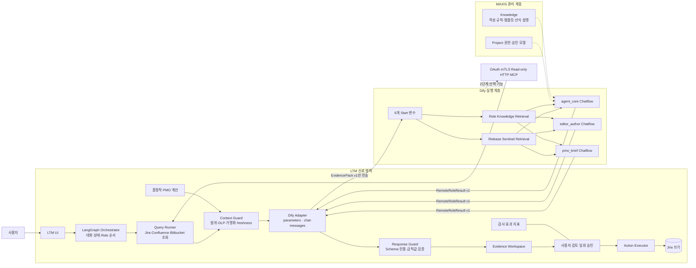
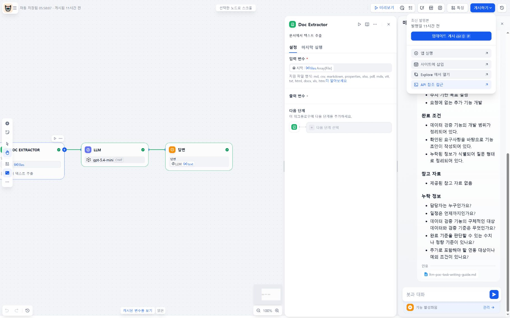
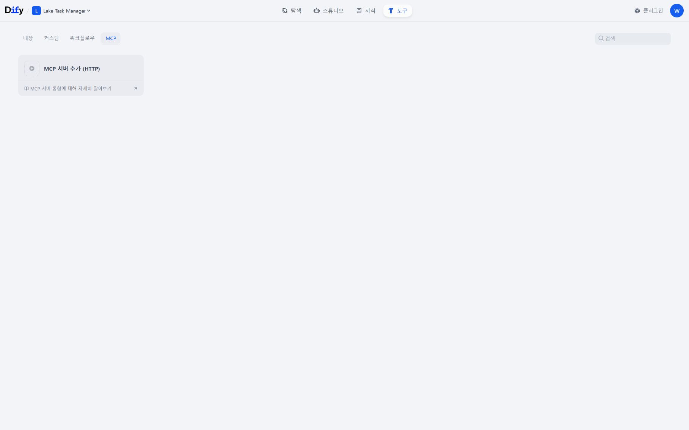
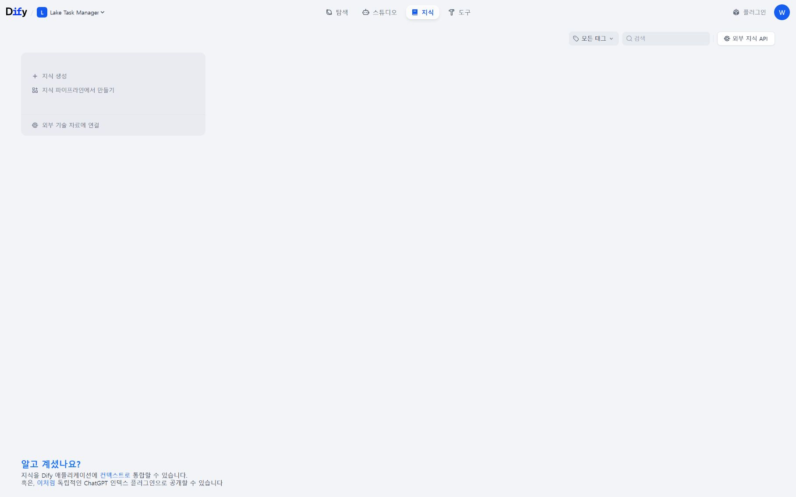
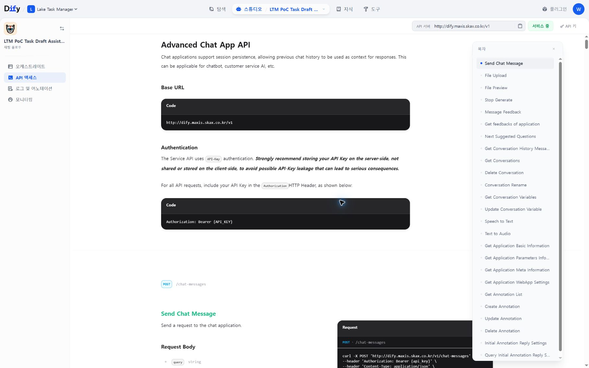
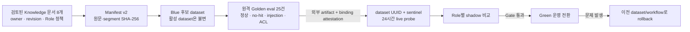
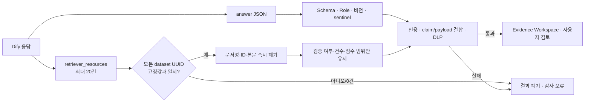
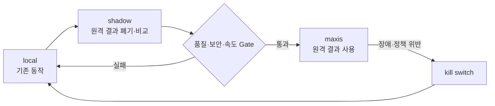

# LTM MAXIS/Dify 적용 아키텍처와 운영 가이드

이 문서는 Lake Task Manager(LTM)의 의미 판단·초안 작성 기능을 MAXIS/Dify로
이관할 때의 구현 경계와 승격 절차를 정의한다. 핵심 원칙은 다음과 같다.

> MAXIS/Dify는 **근거를 바탕으로 제안**하고, LTM은 **사실 조회·계산·검증·승인·실행**한다.

현재 코드의 런타임 연동 대상은 별도 `MAXIS API`가 아니라 **MAXIS가 관리하는 Dify
Service API**의 `/parameters`와 `/chat-messages`다. 전체 LangGraph 오케스트레이션과
대화 상태는 LTM이 유지하고, Dify는 요청마다 지정된 Role 하나를 stateless로 실행한다.
MAXIS Project·권한·Knowledge 운영은 이 실행 경로를 둘러싼 사내 거버넌스 계층이다.

## 1. TO-BE 구조



### 직접 확인한 현재 Dify 환경

기존 PoC는 Knowledge 조회·문서 추출·LLM·Answer를 잇는 Chatflow이며 게시와 API
접근 메뉴를 제공한다. 합성 요청 시험에서는 입력에 없던 담당자와 날짜를 만들지는 않았지만,
strict JSON·source ID·freshness 계약은 없었다. 따라서 기존 앱을 운영 경로로 바로 쓰지 않고
아래 세 앱 계약으로 재구성한다.



Dify 도구 화면에서 HTTP MCP 서버 등록 기능을 확인했다. 이 화면에 연결할 대상은 로컬 PC가
아니라 OAuth·mTLS를 적용해 중앙 배포한 읽기 전용 LTM MCP다.



Knowledge 화면은 Dify 내부 지식 생성·파이프라인과 외부 지식 API 연결을 지원한다. 정적
작성 규칙은 Knowledge로, 최신 Jira 사실은 EvidencePack으로 나누는 이유다.



현재 dev 앱의 Service API는 Advanced Chat API와 `/chat-messages`를 제공하지만 화면에
표시된 Base URL이 평문 HTTP다. 합성 화면 시험 외에 내부 데이터를 전송하지 않으며,
승인된 HTTPS endpoint가 제공될 때까지 LTM의 보안 정책이 활성화를 거부한다.



### 역할 분담

| 계층 | 책임 | 소유하지 않는 것 |
|---|---|---|
| LTM | 최신 원천 조회, PMO 산식, 허용 범위, DLP, 결과 검증, 승인, Jira 쓰기 | 원격 Prompt/Workflow 운영 |
| MAXIS | 사내 Project, 승인 모델, Knowledge, 권한·자산 거버넌스 | LTM 승인 토큰과 Jira 쓰기 권한 |
| Dify | 역할 라우팅, RAG, 의미 해석, 초안·보고 문장 생성 | 수치 재계산, 최종 승인, 직접 변경 |
| HTTP MCP | 중앙에서 승인한 읽기 전용 Tool 제공 | 생성·수정·삭제 Tool |

`Query Runner`, `Action Executor`와 승인 토큰은 항상 LTM에 남는다. `Research Analyst`는
현재 public web/GitHub 근거에 대한 tenant·host 계약이 없어 로컬 수집·종합을 유지하고,
검증된 결과만 후속 원격 Role에 전달한다. `People Advisor`도 실행 가능한 담당자 ID를
원격 모델이 만들지 못하도록 이번 단계에서는 로컬 고정이다. Editor의 기존 담당자 표시는
EvidencePack에서 HMAC 기반 `[[person:…]]` 참조로만 전송하고, authoritative 결과에 한해
그 요청에서 검증한 로컬 매핑으로 복원한다.

현재 원격 실행 허용 Role은 `Request Architect`, `Query Specialist`, `Knowledge Curator`,
`Portfolio Analyst`, `Work Architect`, `Auditor`, `Result Integrator`, `Editor Author` 8개다.
여기서 원격 `Auditor`는 조언형 의미 검토자이며, 최종 계약·인용·쓰기 통제는 LTM 코드가
수행한다. Registry와 build spec에 남아 있는 `Research Analyst`와 `People Advisor` 계약은
향후 검토용이며 현재 runtime authority가 항상 local로 강제한다.

### 구현 범위와 추가 도입 과제

| 영역 | 이번 브랜치에서 구현 | 운영 도입 전에 추가할 것 |
|---|---|---|
| Agent | 8개 의미 Role의 `local / shadow / maxis` route, Research·People·조회·쓰기는 local | 실제 Role별 업무 품질 검증과 운영 책임자 |
| Workflow | LTM 오케스트레이션, stateless Role 호출, schema·version fail-closed | 게시 Dify DSL/export hash와 node 오류 주입 시험 |
| Knowledge/RAG | 문서·segment hash manifest, dataset/sentinel 결속, 25-case 명세 | 원격 dataset 생성, Role ACL filter, 서명된 평가 artifact |
| MCP/Tool | OAuth·mTLS·Host 제한의 read-only HTTP 서버 | 중앙 배포와 사용자별 Jira OBO/sidecar topology |
| HITL/쓰기 | actor·payload·capability 결속, 직전 권한 재확인, 일회 승인 | 고위험 2인 승인, 모든 작업의 typed receipt, 부분실패 보상 |
| Eval | live canary, Role별 shadow gate, prod attestation gate | 실제 25건 실행, 사람 blind review, timeout/injection/failure eval |
| 관측/KPI | 내용 없는 로컬 audit·impact 집계 | 수작업 baseline, 처리량·p95·비용, 중앙 fleet 집계 |
| 보안/운영 | DLP, prod HTTPS, profile fingerprint, kill switch | 목적지 allowlist, 중앙 Secret gateway, WORM 감사 저장소 |
| Release/Rollback | 버전 pin과 설정 변경 시 기존 실행 무효화 | import 가능한 배포본, 이전 prod snapshot, 전사 kill switch·복구 훈련 |

## 2. 실행 프로필

MAXIS/Dify 설정은 기존 LLM Provider 설정과 분리한다. 코드를 다시 빌드하지 않고
UI 또는 환경변수로 활성 프로필을 바꾼다.

| 항목 | dev | prod |
|---|---|---|
| 데이터 정책 | `synthetic_only` | `internal_read_only` |
| HTTP 허용 | loopback 개발 서버만 | 금지, HTTPS 필수 |
| 용도 | 합성 데이터 계약 시험 | 승인된 내부 업무 데이터 |
| 자격증명 | Windows 사용자 DPAPI 또는 환경변수 | 배포 Secret 환경변수 권장 |

DEV에서는 사용자가 입력한 질문·근거·Role context·사용자 식별값을 그대로 보내지 않는다.
네트워크 직전 모두 고정 합성 fixture와 합성 가명으로 교체하며, DEV는 canary와 shadow 전용이다.
`maxis` authoritative route는 서버와 UI 양쪽에서 거부한다.

환경변수는 저장된 UI 설정보다 우선한다.

```text
LAKE_MAXIS_PROFILE=dev|prod
LAKE_MAXIS_BASE_URL=https://<approved-dify-host>/v1
LAKE_MAXIS_WORKFLOW_BUNDLE_VERSION=<release-manifest-version>
LAKE_MAXIS_KNOWLEDGE_VERSION=<knowledge-manifest-version>
LAKE_MAXIS_KNOWLEDGE_DATASET_ID=<canonical-dify-dataset-uuid>
LAKE_MAXIS_KNOWLEDGE_SENTINEL_SHA256=<sha256-of-retrieved-release-marker>
LAKE_MAXIS_REMOTE_LOG_POLICY_ID=<manager-approved-policy-reference>
LAKE_MAXIS_REMOTE_LOG_MODE=redacted|approved_bounded_content
LAKE_MAXIS_REMOTE_LOG_RETENTION_DAYS=<0..90>
LAKE_MAXIS_KNOWLEDGE_EVAL_ATTESTATION=<ltm-maxis-knowledge-eval-attestation.v1 JSON>
LAKE_MAXIS_AGENT_CORE_VERSION=<published-workflow-id>
LAKE_MAXIS_EDITOR_AUTHOR_VERSION=<published-workflow-id>
LAKE_MAXIS_PMO_BRIEF_VERSION=<published-workflow-id>
LAKE_MAXIS_AGENT_CORE_API_KEY=<server-side secret>
LAKE_MAXIS_EDITOR_AUTHOR_API_KEY=<server-side secret>
LAKE_MAXIS_PMO_BRIEF_API_KEY=<server-side secret>
```

API Key는 브라우저에 다시 표시하지 않으며 로그·prefs·Git에 저장하지 않는다. Windows
UI 저장은 현재 사용자 범위 DPAPI를 사용한다. 프로필이나 Key가 바뀌면 이전 연결 검증은
즉시 무효가 된다. 다만 prod 공용 Dify App Key를 여러 사용자 PC의 DPAPI에 배포하는 것은
회수·회전·사용자별 추적 측면에서 최종 운영 구조가 아니다. 운영 단계에서는 exact 목적지
allowlist를 가진 사내 OAuth/OBO gateway가 Dify Key를 중앙 보관하고, LTM에는 사용자별
단기 토큰만 주는 구조를 우선 검토한다.

각 dev/prod 프로필은 별도의 Dify Knowledge dataset UUID를 필수로 가진다. LTM은
`config/maxis-knowledge.yml`의 문서별 stable ID·owner·classification·audience·허용 Role·
revision·`reviewed_for_version`·UTC `reviewed_at`·비식별 `reviewer_digest`와 chunk 정책,
원문 SHA-256, heading별 segment ledger,
Knowledge version, dataset UUID를 canonical manifest로 묶어 다시 SHA-256한다. 이 digest는
공개 가능한 배포 식별자로서 프로필 fingerprint, 연결 canary, Agent thread snapshot, 모든
원격 `EvidencePackV1.knowledge_manifest_sha256`에 동일하게 고정한다. 문서·정책·Role registry·
segment·dataset 중 하나가 달라지면 기존 probe와 진행 중 원격 thread를 재사용하지 않는다.
Manifest 공개 메타데이터에는 segment 본문을 넣지 않는다. Runtime이 받은 Knowledge
version을 검토 버전으로 자동 기입하지 않는다. 8개 문서의 `reviewed_for_version`이 정확히
같고 현재 profile version과 일치하며, `reviewed_at`이 `review_cycle_days` 이내일 때만
manifest를 만든다. Golden eval 명세 원문 SHA-256도 governance에 고정하고 validator가
실제 `knowledge-evals.yml`과 대조한다. 현재 동일한 비인적 `reviewer_digest`는 저장소
checkpoint 식별자일 뿐 문서 owner의 실제 승인 서명은 아니다. 운영 release에는 owner별
승인 증적 또는 승인 시스템의 서명된 release record를 별도로 연결해야 한다.

또한 dataset마다 `LTM_RELEASE_SENTINEL_V1=<환경별 난수>` 문서를 둔다. Dify의 전용
Knowledge Retrieval node가 이 줄을 찾아 `knowledge_proof`로 반환하면 LTM이 로컬 프로필의
SHA-256과 비교한다. 기대 원문·digest는 여섯 Start 변수 어느 곳에도 싣지 않는다. 따라서
단순 manifest echo와 달리 잘못된 dataset binding이나 누락된 Retrieval node를 활성화 전에
찾을 수 있다. 이는 배포 배선 canary이며, 의도적으로 표식을 hard-code한 악성 Workflow를
막는 암호학적 증명은 아니다.



현재 LTM은 단일 dataset의 문서별 metadata filter를 실행 시 강제하지 않는다. 따라서 현 릴리스는
모든 문서를 `internal / all_ltm_users`로 제한한다. `allowed_roles`는 의도와 평가 기준이지 현재의
보안 경계가 아니다. 제한 문서를 추가하려면 Role별 dataset 분리 또는 서버 측 metadata filter를
먼저 구현하고 ACL-negative 원격 평가 증빙을 통과해야 한다. 체크인된 25개 평가는 실행 명세이며,
원격 MAXIS/Dify에서 성공했다는 주장이 아니다.
Prod authoritative 전환은 별도 외부 artifact의 ID, `outcome=passed`, `case_count=25`,
artifact/suite SHA-256, 통과 UTC 시각과 현재 dataset·manifest·세 Workflow version·비밀을
제외한 profile material digest를 담은 attestation을 요구한다. LTM은 이 metadata binding만
검증하며 외부 artifact를 읽거나 서명 검증·25건 재실행을 하지 않는다. 따라서 운영 승격에는
서명된 원격 결과 artifact, 대표 업무의 사람 blind review, prompt-injection·timeout·node
failure 시험을 release 절차로 추가한다. Role당 5건의 shadow 비교는 구조·숫자·어휘 회귀
탐지용이지 의미 정확도의 최종 증명이 아니다.

Workflow ID는 현행 Dify가 게시 시 발급한 canonical UUID를 우선 사용한다. 기존 MAXIS
fork가 opaque revision 이름을 쓰는 동안에는 그 값을 강제로 변환하지 않고 호환 입력으로
허용한다. 대신 연결 검증이 실제 `/chat-messages` 요청에 그 ID를 전달하고 응답의
`workflow_version`이 정확히 같은지 확인한다. 서버가 legacy ID를 받지 않는 버전으로
승격되면 검증이 실패하므로 해당 앱을 UUID로 다시 게시한 뒤 프로필을 갱신한다. ID를
요청에서 조용히 빼거나 실패한 버전을 자동 치환하지 않는다.

현재 `deploy/maxis-dify/`는 수동 builder를 위한 검증 가능한 **build specification**이며
import 가능한 Dify DSL/export는 아니다. 그러므로 live canary 성공만으로 원격 prompt,
node graph, retry/fallback 설정이 저장소와 동일하다고 증명할 수 없다. 운영 release에는
Dify export/DSL 또는 관리자 export artifact의 hash를 profile material에 묶고, 이전 prod
export와 profile snapshot을 함께 보존해야 한다.

한 Agent 대화는 시작 시 `profile + route + workflow/knowledge version`을 고정한다.
대화 도중 설정이 달라지면 새 대화를 요구해 서로 다른 버전의 결과가 섞이지 않게 한다.
원격 호출이 진행되는 동안 kill switch나 profile이 바뀐 경우에도 응답 직후 다시 검증해 해당
결과를 폐기한다. 연결 검증은 24시간 뒤 만료되며, 누락·미래·파싱 불가능한 시각도 만료로 본다.

## 3. 세 개의 Dify 앱 계약

모든 앱은 `POST /v1/chat-messages`, blocking, stateless 방식의 Chatflow로 게시한다.
Start 입력은 임의 상태가 아니라 아래 여섯 필드만 받는다. `context_pack`은 Dify의
Paragraph 입력 호환성을 위해 검증된 `EvidencePackV1`을 canonical JSON 문자열로
직렬화한 값이다.

`context_pack`, `role_id`, `correlation_id`, `output_contract`, `workflow_version`,
`knowledge_version`

게시 앱의 `/parameters`도 이름만 보지 않는다. `context_pack`은 최소 20,000자의 Paragraph,
나머지는 최소 128자의 Text Input이어야 한다(`max_length` 미지정은 무제한으로 인정). 작은
합성 canary만 통과하고 실제 EvidencePack이 잘리는 배포 설정을 활성화 단계에서 차단한다.

모든 critical Knowledge Retrieval·LLM·Answer node는 실패 시 run을 종료한다. 자동 retry,
default value, failure-branch 답변, model fallback은 사용하지 않는다. LTM도 MAXIS 실패를 Local
결과로 조용히 바꾸지 않는다. 요청에는 게시 `workflow_id`, 빈 `conversation_id`,
`auto_generate_name: false`를 명시해 버전과 stateless 실행을 고정한다.

| 앱 | 대상 | 입력 | 출력 |
|---|---|---|---|
| `agent_core` | 요청 분석, 조회 계획, 근거 정리, 업무 구조화, 감사, 응답 통합 | `context_pack`, `role_id`, 버전·상관 ID | `RemoteRoleResultV1` |
| `editor_author` | Description·Comment의 의미 초안 | 동일 | `RemoteRoleResultV1(payload=EditorDraftV1)` |
| `pmo_brief` | LTM이 계산한 변화·위험의 설명 | 동일 | `RemoteRoleResultV1(payload=PortfolioResultV1)` |

응답은 Markdown 코드 블록 없이 단일 JSON 객체여야 한다.

```json
{
  "contract": "remote-role-result.v1",
  "role_id": "work_architect",
  "status": "ok",
  "payload": {
    "summary": "근거에서 확인한 사실"
  },
  "claims": [
    {
      "claim_id": "claim_1",
      "kind": "fact",
      "text": "근거에서 확인한 사실",
      "citation_ids": ["citation_1"]
    }
  ],
  "payload_claims": [
    {
      "path": "/summary",
      "claim_ids": ["claim_1"]
    }
  ],
  "citations": [
    {
      "citation_id": "citation_1",
      "source_id": "ctx_...",
      "locator": "필드 또는 문단"
    }
  ],
  "missing_inputs": [],
  "warnings": [],
  "workflow_version": "<published-version>",
  "knowledge_version": "<knowledge-manifest-version>",
  "knowledge_manifest_sha256": "<64-char-manifest-sha256>",
  "knowledge_proof": "LTM_RELEASE_SENTINEL_V1=<retrieved-release-marker>"
}
```

사실·추론·권고는 반드시 전달받은 `source_id`를 인용해야 한다. 의미 있는 payload 필드는
JSON Pointer 기반 `payload_claims`로 해당 claim과 연결해야 하며, LTM은 식별자·숫자·URL의
정확한 출처 일치와 fact 문장의 70% 이상 lexical grounding을 기계적으로 확인한다. 이는
의미적 진실 판정이 아니므로 해석은 근거를 인용한 `inference`로, 아직 근거가 없는 사항은
`open_fact` 또는 `missing_inputs`로 분리한다. Dify는 입력 수치를 다시
계산하거나 담당자·일정·URL을 추측하지 않는다. 또한 응답의
`knowledge_manifest_sha256`은 입력 EvidencePack 값을 그대로 반환해야 하며, LTM은 고정된
프로필의 값과 정확히 일치하지 않으면 연결 검증과 실제 실행을 모두 차단한다.

## 4. 신뢰 경계

### LTM → MAXIS/Dify

`ContextGuard`가 만든 `EvidencePackV1`만 네트워크를 통과한다.

- 최대 source 10개, source당 1,500자, 전체 20,000자
- 허용 Jira Project·Confluence Space·Bitbucket Repository만 포함
- 조회·갱신 시각과 content SHA-256 포함
- 사용자·담당자 식별자는 LTM 프로세스 범위의 비가역 가명으로 치환
- 이메일, 사번 패턴, Authorization/JWT/API Key/Password 차단
- 승인 토큰, 실행 receipt, 전체 대화/상태 객체 전송 금지
- 15분 freshness 표시; 변경 초안의 오래된 근거는 실패 처리

### MAXIS/Dify → LTM

`ResponseGuard`를 통과한 결과만 기존 Role 검증기로 전달한다.

- strict JSON, 추가 필드 금지
- 역할 ID·Workflow 버전·Knowledge 버전 일치
- fact/inference/recommendation의 source 인용 강제
- `retriever_resources`는 최대 20건만 읽고 모든 dataset UUID가 고정값인지 확인
- 검색 문서명·문서/segment ID·본문은 저장·응답하지 않고 검증 여부·건수·점수 범위만 투영
- Knowledge release sentinel을 실제 실행마다 constant-time SHA-256 비교
- 미제공 source, 식별자, Secret, 승인·변경 capability 차단
- 기존 Role별 Schema와 결정적 후처리 규칙 재검증
- `maxis` 실패 시 로컬 LLM으로 조용히 대체하지 않음
- `shadow` 결과는 화면·상태·승인 payload에 반영하지 않고 폐기

화면에는 source 본문 대신 제목, 원천 ID, 조회·갱신 시각, freshness와
`사실/추론/권고/미확인` 구분만 표시한다. 링크는 MAXIS 응답 URL을 사용하지 않고, LTM이
검증한 단일 Jira key일 때만 same-origin `/browse/KEY`를 생성한다.



## 5. 읽기 전용 HTTP MCP

현재 구현은 기존 LTM MCP Tool을 재사용하되 HTTP transport에는 별도 인증 경계를 둔다.
다만 1단계 Chatflow는 MCP를 호출하지 않고 LTM이 만든 EvidencePack만 받는다. 아래 중앙
HTTP MCP는 네트워크·IdP 승인을 거친 2단계 읽기 확장 경로다.

- OAuth 2.0 token introspection: `active`, subject, audience, `ltm:read`, expiry 확인
- IdP의 승인된 사용자 claim을 실제 LTM/Jira 세션 사용자와 일치시켜 confused-deputy 차단
- 운영은 HTTPS와 mTLS(또는 승인된 mTLS 종료 Proxy) 필수
- DNS rebinding 방지를 위한 Host 제한
- stateless Streamable HTTP `/mcp`
- Jira/Confluence/Bitbucket **읽기 Tool만** 노출
- Token과 introspection 원문은 로그에 남기지 않음

HTTP MCP는 시작할 때 실행 모드를 추론하지 않는다. 중앙 운영 배포는
`LTM_MCP_DEPLOYMENT_MODE=production`과 `JIRA_ENV=prod`를 모두 명시해야 하며, 둘 중
하나가 없거나 서로 어긋나면 시작하지 않는다. `development`는 `JIRA_ENV=mock|local`과
loopback bind/광고 URL만 허용한다. `LTM_MCP_ALLOW_HTTP_LOOPBACK=1`도 development에서만
사용할 수 있다. stdio 개발 명령의 mock 기본값은 해당 명령의 `main()` 안에서만 적용되어,
공유 모듈을 import한 HTTP 프로세스의 Jira 환경을 바꾸지 않는다.

Dify의 `MCP 서버 추가(HTTP)`에는 중앙에 배포된 URL만 등록한다. 사용자 PC의 LTM
포트를 직접 공개하지 않는다. DCR 사용 여부, OAuth client 발급과 방화벽 정책은 사내
IdP·MAXIS 운영팀 승인 후 결정한다. IdP `sub`와 Jira ID가 다르면
`LTM_MCP_OAUTH_IDENTITY_CLAIM`에 운영팀이 승인한 Jira 식별 claim 이름을 지정한다.
바인딩은 그 claim 값과 fresh Jira 응답의 `id`·`key`·`accountId`·`actorAliases`만
비교한다. `displayName`·email·일반 이름은 중복·변경 가능하므로 일치 근거로 사용하지 않으며,
이 필드를 identity claim으로 지정하는 설정도 시작 단계에서 거부한다. claim 매핑 없이 공용
매니저 Jira 세션을 대신 사용하는 구성은 허용하지 않는다.

현재 HTTP MCP 구현은 한 프로세스가 가진 Jira session과 OAuth 주체를 매 호출 대조하지만,
OAuth 주체를 Jira OBO credential로 교환하지는 않는다. 따라서 중앙 다중 사용자 운영 전에는
사용자별 sidecar 또는 delegated Jira gateway 중 하나를 정하고 세션 격리·회수·감사 모델을
검증해야 한다. 그 전까지 MCP는 1단계 Workflow에 연결하지 않는다.

## 6. 승격 절차와 중단 조건



1. 후보 프로필과 세 앱의 버전을 저장한다.
2. 각 앱의 `/parameters` 필수 변수 검사를 통과한다.
3. 각 앱에 익명 합성 `EvidencePackV1`과 `RoleContextV1`을 보내 실제
   `/chat-messages` canary를 실행한다. `RemoteRoleResultV1`, Role, Workflow/Knowledge
   버전, 동적 합성 source 인용, 환경별 Knowledge release sentinel 조회가 모두 맞아야
   프로필이 `verified`가 된다.
4. 프로필을 명시적으로 활성화한다.
5. 역할군을 `local → shadow`로 전환한다. 로컬 결과는 즉시 사용자에게 반환하고,
   MAXIS 호출은 worker 2개·대기 8개로 제한된 비동기 큐에서 실행한다.
6. 외부 25-case 결과 artifact를 보관하고 위 binding attestation을 prod profile 또는
   `LAKE_MAXIS_KNOWLEDGE_EVAL_ATTESTATION`에 등록한다. 이 단계 없이도 prod shadow 후보
   활성화는 가능하지만 authoritative 전환은 불가능하다.
7. 같은 `profile fingerprint + workflow + Role + workflow version + knowledge version`에 대해
   **해당 Workflow의 원격 허용 Role 각각** 완료 표본 5건 이상, 호출 성공률 95% 이상,
   계약·인용 유효율 100%, 구조 유사도 80% 이상, 수치가 있는 표본의 수치 일치율 80%
   이상을 모두 통과한 Workflow만 `maxis`로 전환한다. 한 Role의 표본을 다른 payload 계약의
   승격 근거로 합산하지 않는다.
8. 장애·유출 의심·버전 불일치 시 kill switch를 켠다. 진행 중 대화는 새 대화로
   재시작한다.

현재 kill switch와 dev/prod 두 profile은 개별 LTM 인스턴스의 control plane이다. 이전 prod
설정 이력, 전사 동시 차단, Dify export 자동 복원까지 구현된 blue-green 배포기는 아니다.
실제 rollback은 이전 불변 dataset·Dify export·profile snapshot, fleet-wide kill switch와
복구 리허설을 운영 runbook으로 준비한 뒤 완료로 판정한다.

Canary에는 사내 문서·사용자 ID·승인 정보·API Key가 들어가지 않으며 응답 본문도 저장하지
않는다. 화면과 prefs에는 계약별 성공 여부, 오류 코드, 소요 시간만 남긴다. 원격 transport
실패는 호출 객체가 바뀌어도 `profile fingerprint + workflow key + API Key digest` 범위로
공유된다. 5분 안에 3회 실패하면 2분간 회로가 열리고, 프로필 또는 Key 회전은 새 범위를
사용한다. digest만 프로세스 메모리에 유지하며 원문 Key는 breaker 상태에 저장하지 않는다.

Shadow 비교도 Prompt·로컬 결과·원격 결과·Jira Key·사용자/원본 대화·상관 ID를 저장하지 않는다.
비교 worker 안에서만 구조, 숫자, 비어 있음, 어휘 겹침을 계산하고
`.cache/maxis_shadow_quality.json`에는 불변 배포 차원별 누계와 비율만 기록한다. 큐가 차면
로컬 응답을 지연시키지 않고 해당 shadow 실행을 버린 뒤 `queueDropped` 카운터만 올린다.
큐에는 원격 전송이 허용된 bounded EvidencePack과 가명 요청 ID만 들어가며, Editor shadow는
원본 사용자 ID 역매핑 없이 EvidencePack에 이미 있던 opaque person marker만 허용한다.
`prod` 프로필은 `shadow` 후보로 활성화할 수 있지만, `maxis` route 전환 또는 이미
`maxis`인 route를 가진 상태의 prod 활성화에는 eval attestation과 shadow Gate가 함께
강제된다. 버전·Knowledge 문서·dataset·eval suite·attestation이 바뀌어 profile fingerprint가
달라지면 기존 authoritative runtime과 이전 표본은 자동으로 승격 근거에서 제외된다.

운영 MAXIS가 비 HTTPS Service API만 제공하면 실제 업무 데이터 경로는 활성화하지
않는다. endpoint, 인증서 체인, 로그 보존·마스킹 정책이 승인된 뒤 `prod`를 검증한다.
`LAKE_MAXIS_REMOTE_LOG_POLICY_ID`, `LAKE_MAXIS_REMOTE_LOG_MODE`,
`LAKE_MAXIS_REMOTE_LOG_RETENTION_DAYS`는 그 승인을 식별하는 **관리자 attestation**이며,
Dify Workspace의 실제 로그 설정을 기술적으로 읽어 증명하지는 않는다. 따라서 정책 소유자의
승인 기록과 Dify 관리자 화면의 보존·접근 ACL 증빙을 함께 보관해야 한다. 이 세 값이 없거나
바뀌면 prod probe·활성화와 기존 thread fingerprint는 fail-closed된다.

MAXIS control-plane의 profile·probe·route·activate·kill switch 변경은 임시 파일 fsync,
원자 교체, read-back 일치 확인이 모두 성공해야 완료로 응답한다. 저장 실패를 성공으로 표시하지
않는다. Jira 변경 승인 capability는 초안을 만든 시점의 Jira actor에 묶고, 승인 재개 시점과
실제 write tool 경계에서 `/myself`를 새로 조회한다. 사용자가 바뀌거나 확인할 수 없으면 묶인
승인을 폐기한다. 단, `/myself` GET과 이어지는 Jira mutation POST는 Jira가 제공하는 하나의
원자 transaction이 아니므로 극히 작은 세션 변경 간격은 남는다. 댓글·링크·상태 전이와 복합
카드는 아직 typed execution receipt를 발급하지 않으며, 고위험 작업의 2인 승인과 부분실패
보상도 후속 통제다.

## 7. 심사 피드백에 대한 검증 지표

LTM은 사용자 내용이 아닌 집계 메타데이터만 `.cache/agent_impact.json`에 기록하고,
원격 호출 lifecycle은 내용 없는 `.cache/maxis_audit.jsonl` 감사 ledger로 분리한다.
변경 이벤트는 Jira의 안정 actor ID, 사용자가 승인한 payload, 일회 capability를 각각
SHA-256으로 비식별화하고, 세 digest와 correlation/thread/action digest를 프로세스 HMAC으로
봉인한다. `change.proposal`·`approved`·`cancelled`·`execution`은 이 결속이 없거나 변조되면
기록되지 않으며, 실행 영수증이 발급된 경로는 검증된 `execution-receipt.v1` 전체 digest와
기존 HMAC signature까지 연결한다. 현재 receipt를 발급하지 않는 댓글·링크·상태 전이 및
복합 카드 경로는 `not_issued`/`compound_primary`로 명시해 더 강한 보장을 주장하지 않는다.
효과 집계는 feature·Role·local/MAXIS engine·profile·Workflow bundle·Knowledge version·
manifest SHA별 segment로도 나뉘어 Local 초안과 MAXIS 초안의 전환 효과를 같은 배포 단위에서
비교할 수 있다. Jira Dashboard·수작업의 도입 전 baseline은 아직 자동 수집하지 않으므로,
PoC 시작 전 동일 업무 20건의 소요 시간·오류·처리량을 별도 측정해 대조한다. 설정 변경 API와
연결 확인·활성화·route·kill switch는 manager만 실행한다. 현재 집계는 사용자 PC 로컬 단위이며
end-to-end 처리 시간, 시간당 처리량, p95 latency, token/cost, fleet-wide 추세는 별도 중앙
관측 파이프라인이 있어야 측정할 수 있다.

단, 이 JSONL은 사용자 PC의 권한 제한·fsync·rotation을 적용한 **로컬 append 로그**일 뿐,
중앙 immutable/WORM 저장소나 외부 timestamp로 보호되는 tamper-proof ledger가 아니다.
로컬 관리자·디스크 손상까지 견디는 감사 증빙이 필요하면 운영 배포 전에 승인된 중앙 보안
로그 sink로 digest 이벤트를 전송하고 보존·접근·무결성 정책을 별도로 적용해야 한다.

| 피드백 | 구현 근거 | 측정 예 |
|---|---|---|
| 기존 Dashboard와 AI 차별성 | PMO Delta Briefing, 근거 기반 Task/Comment 초안 | 승인율, 큰 수정 없는 승인율, 평균 검토 시간 |
| 지식 체계 | Workflow/Knowledge version 고정, source manifest | 버전별 계약 통과율, 인용 완전성 |
| LTM·Agent 역할 불명확 | Context/Response Guard와 로컬 승인·실행 경계 | 원격 쓰기 Tool 0개, 경계 위반 차단 건수 |
| 권한·민감정보·감사 | DPAPI/환경 Secret, DLP, OAuth/mTLS MCP, 감사 이벤트 | Secret 노출 0, 승인 없는 변경 0 |
| 최신성·정확도 | retrieved/updated 시각, freshness, 결정적 PMO 산식, 비동기 shadow 품질 Gate | stale 차단율, 수치·구조·인용 일치율, 호출 성공률·지연 |

효과 지표에는 Prompt·생성문·Jira Key·사용자 ID·API Key·승인 토큰을 저장하지 않는다.

## 8. 운영 준비 체크리스트

- [ ] MAXIS Project와 Dify Workspace의 소유자·운영자 지정
- [ ] 세 Chatflow의 strict JSON 출력과 게시 버전 고정
- [ ] 운영 HTTPS Gateway와 인증서 검증
- [ ] API Key 발급·회전·회수 절차와 배포 Secret 등록
- [ ] Knowledge manifest, 청크 기준, 갱신 책임자 지정
- [ ] 문서별 owner·revision·reviewed_for_version·UTC reviewed_at·비식별 reviewer digest와 90일 최대 검토 주기 확인
- [ ] dev/prod Dify Knowledge dataset UUID 분리 및 `LAKE_MAXIS_KNOWLEDGE_DATASET_ID` 등록
- [ ] 환경별 release sentinel 문서 업로드 및 `LAKE_MAXIS_KNOWLEDGE_SENTINEL_SHA256` 등록
- [ ] 후보 dataset에서 Knowledge Golden eval 25건 실행, 외부 artifact 보관, exact-binding attestation 등록
- [ ] 설정 화면의 Knowledge manifest SHA와 Dify에 게시한 dataset release 대조
- [ ] critical node terminate, retry/default/failure answer/model fallback 비활성 확인
- [ ] 합성 데이터 회귀 → shadow 비교 → 제한 사용자 PoC 순서 준수
- [ ] prod 대상 Workflow별 exact-version shadow 표본 5건과 승격 Gate 통과 확인
- [ ] Dify/MAXIS/LTM 상관 ID로 장애 추적 가능 여부 확인
- [ ] Dify 로그 보존·접근 ACL·입출력 마스킹 승인 및 remote-log attestation 3개 값 등록
- [ ] kill switch 훈련과 복구 절차 검증
- [ ] HTTP MCP는 중앙 배포·OAuth/mTLS 승인 전 비활성 유지

## 9. 공식 동작 근거와 MAXIS 재검증 항목

- [Dify Chat Messages API](https://docs.dify.ai/en/api-reference/chat-messages/send-chat-message)는
  게시 workflow 지정과 `metadata.retriever_resources`의 dataset/document/segment/score 구조를
  설명한다. LTM은 이 중 dataset 일치와 bounded score 요약만 유지한다.
- [Dify Run history](https://docs.dify.ai/zh/cloud/use-dify/debug/history-and-logs)는 실행별
  원시 input/output과 시스템 metadata·trace를 확인할 수 있음을 보여 준다. 그래서 prod는
  별도 원격 로그 승인과 실제 관리자 설정 대조 없이는 활성화하지 않는다.
- [Dify Version control](https://docs.dify.ai/zh/cloud/use-dify/build/version-control)은
  draft/latest/history/restore와 지정 버전 실행을 설명한다. 일부 기능의 plan 제한과 사내
  MAXIS fork 차이가 있을 수 있으므로 실제 endpoint probe와 rollback 훈련을 최종 근거로 삼는다.
- [Dify Error handling](https://docs.dify.ai/zh/cloud/use-dify/build/predefined-error-handling-logic)은
  terminate/default/fail-branch 전략을 제공한다. LTM 운영 bundle은 그중 terminate만 허용하고
  자동 생성된 fallback 답변은 금지한다.
- [Dify API 시작 가이드](https://docs.dify.ai/en/api-reference/guides/get-started)에 따라 App
  API Key는 backend에서만 사용한다. Knowledge 범용 Key를 LTM 클라이언트에 배포하지 않는다.
