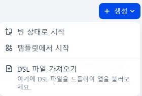
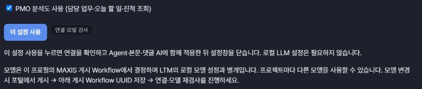
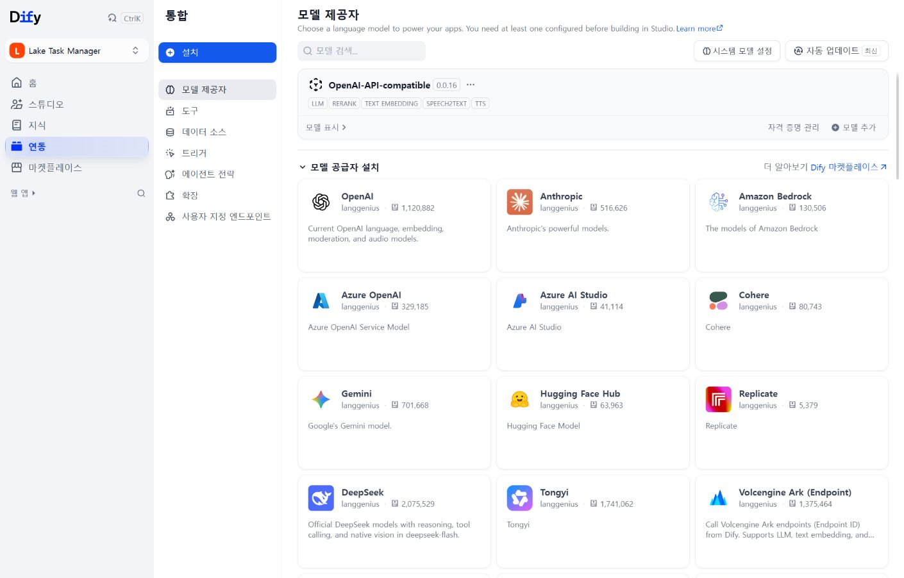
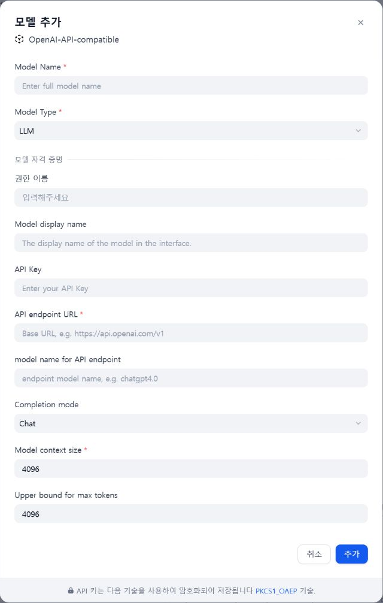
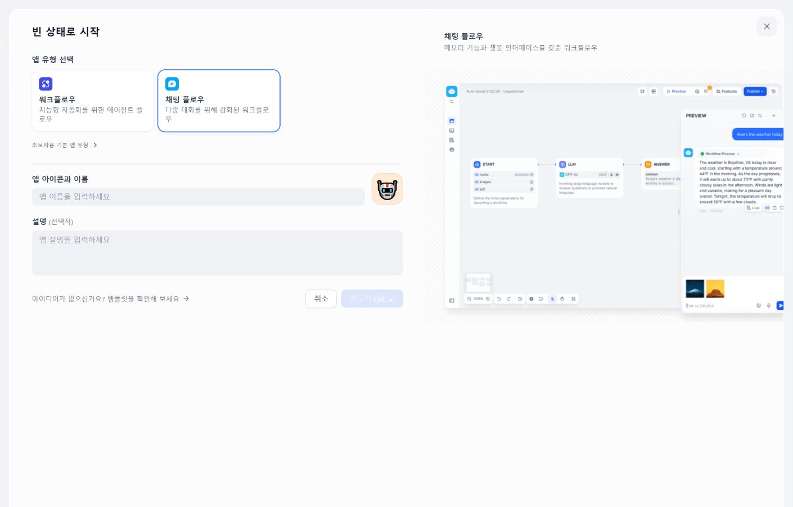
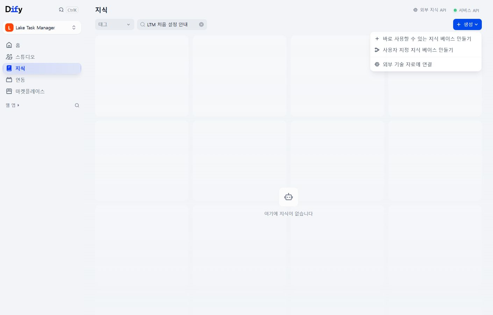
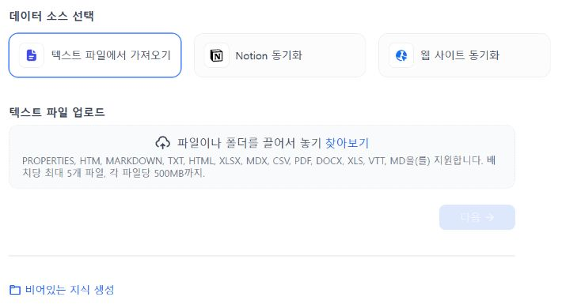
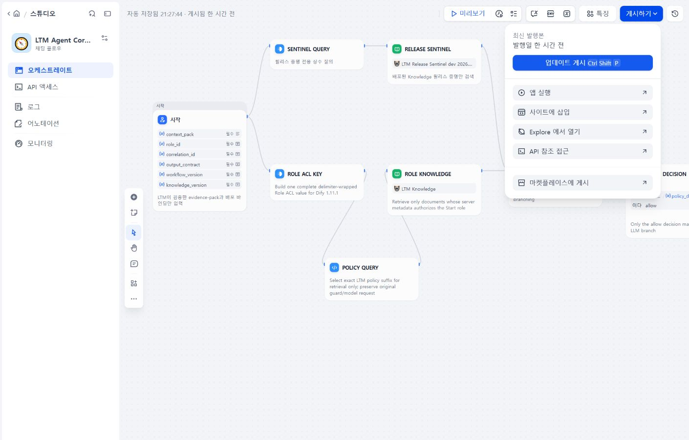

# MAXIS / Dify 설정 가이드 — 새 서버(PROD) 적용

**Dify에 LTM 앱이 하나도 없는 상태에서 시작하는 가이드다.**
여기서 **Dify 앱**은 PC에 설치하는 프로그램이 아니라, 브라우저의 **스튜디오에서 만드는 Chatflow**다.
Core·Editor 앱을 먼저 갖고 있을 필요가 없다. 아래 4단계의 **DSL 파일 가져오기 자체가 앱을 만든다.**
DEV 서버나 DEV PC의 `.cache`를 가져오지 않고, 저장소와 현지 서버 정보로 준비한다.

> 사진은 현재 접근 가능한 Dify와 LTM에서 촬영한 **조작 위치 안내**다. PROD 적용 성공 증거가 아니다.
> 왼쪽 메뉴·페이지 제목·조작 버튼이 함께 보이도록 촬영하고 하단 계정 영역만 제외했다.
> Studio/Knowledge 목록 사진은 기존 자산을 노출하지 않도록 **검색 필터를 적용한 화면**이다. 실제 빈 PROD 계정의 캡처는 아니다.
> 키·실제 주소·자산 ID는 제외했다. 사진 속 기존 앱·Knowledge 이름은 예시이며 날짜 이름을 따라 만들지 않는다.
> PROD의 메뉴 이름은 설치 버전에 따라 조금 다를 수 있다.
> 사진은 저장소의 Markdown 미리보기 또는 GitHub에서 볼 수 있다. LTM의 기존 가이드 링크는 텍스트 원문을 연다.

| 순서 | Dify에서 할 일 | 로컬 명령 / 완료 확인 |
|---|---|---|
| 0 | **현지 Dify 접속 → 워크스페이스 → 스튜디오** | 앱 목록이 비어 있어도 정상 |
| 1 | 모델 제공자·인증 연결, 실제 생성 확인 | 모델 YAML 내보내기 |
| 2 | 업무 Knowledge + 별도 검증 표식 등록 | `maxis_setup.py prepare` |
| 3 | 현지 모델·Knowledge ID 확인 | `maxis_setup.py bundle`로 가져오기 파일 생성 |
| 4 | DSL 가져오기로 LTM 앱 생성 → Publish → 앱별 API Token | Core·Editor 앱과 게시 UUID 확보 |
| 5 | LTM 연결 검사·정책에 따른 검수·적용 | `maxis_setup.py connect` → `status` → **이 설정 사용** |

## 0. 지금 어디서 시작하나? — 앱이 없어도 여기부터

1. 브라우저에서 관리자가 제공한 **PROD Dify 웹 주소**에 접속하고 로그인한다.
   MAXIS 포털 주소와 Dify 주소는 다를 수 있다. **DEV 주소를 PROD에 입력하지 않는다.**
   현지 Dify 주소·계정·워크스페이스 권한 자체가 없다면 먼저 관리자에게 받아야 한다. 저장소가 서버 계정이나 접근 권한을 만들지는 않는다.
2. Dify 로고와 왼쪽 **홈 / 스튜디오 / 지식 / 연동** 메뉴가 보이는지 확인한다.
   **Project / Node / Knowledge / Chatflow Creator**가 보이면 MAXIS 포털 화면이다.
   그 화면의 버튼을 아래 Dify 버튼과 대응시키지 말고, 현지 Dify 웹 주소를 연다.
3. 왼쪽 위 워크스페이스 선택에서 **작업할 현지 프로젝트/워크스페이스**를 선택한다.
   사진의 `Lake Task Manager`라는 워크스페이스가 PROD에 존재한다고 가정하지 않는다.
4. **왼쪽 스튜디오 → 오른쪽 위 생성**을 누른다. 아래처럼 두 경로가 있다.



| 이 메뉴 | 언제 사용하나? |
|---|---|
| **빈 상태로 시작 → 채팅 플로우** | 1단계에서 모델 연결만 확인할 작은 앱을 처음 만들 때 |
| **DSL 파일 가져오기** | 4단계에서 저장소가 생성한 **LTM Core·Editor 앱을 처음 등록**할 때 |

**지금은 LTM 앱을 손으로 만들지 않는다.** 먼저 아래 로컬 준비와 1~3단계를 완료한다.
그때 생성되는 YAML을 가져오면 노드·프롬프트·연결이 있는 LTM 앱이 만들어진다.
생성 버튼이 없으면 검색 결과 문제가 아니라 워크스페이스/편집 권한부터 관리자와 확인한다.

```text
현지 Dify 웹 주소                       ← 브라우저 로그인용, 관리자가 제공
  /apps                                ← 스튜디오: 앱 만들기 / DSL 가져오기
  /integrations/model-provider         ← 연동 → 모델 제공자
  /datasets                            ← 지식: Knowledge 만들기
  /app/<현지 앱 ID>/workflow            ← 생성된 앱 → 오케스트레이트
  /app/<현지 앱 ID>/develop             ← 생성된 앱 → API 액세스

현지 Dify Service API 주소 …/v1         ← 나중에 LTM에 입력, 웹 관리 화면이 아님
```

경로는 촬영한 설치본 기준이다. `<현지 앱 ID>`를 직접 만들거나 위 경로를 추측해 조합하지 말고 **화면 메뉴로 이동**한다.

### 먼저 구분할 주소와 인증정보

| 항목 | 어디에 입력하나 | 다른 것으로 대체할 수 있나? |
|---|---|---|
| MAXIS/Dify 포털 URL + ID/PW | 브라우저 로그인 | LTM API Token이 아님 |
| 모델 게이트웨이 URL + 모델 인증키 | Dify **연동 → 모델 제공자** | 앱 Token이 아님 |
| Dify Service API URL (`https://…/v1`) | LTM 설정의 `baseUrl` | 포털 `/apps`·`/console/api` 주소가 아님 |
| Core / Editor / PMO 앱별 API Token | LTM 숨김 입력 또는 설정 UI | 모델 인증키·Knowledge API Key가 아님 |

**Dify의 모델 등록과 자격 증명 활성화, Chatflow 초안 저장과 Publish는 각각 별개다.**
실제 모델은 **연결한 Dify 앱의 게시 LLM 노드**가 선택한다. LTM의 로컬 LLM 모델 선택과 무관하며,
MAXIS 프로필마다 다른 서버·모델·플러그인을 쓸 수 있다.

### API Key 연결 후 이력 대화 확인

LTM에는 **게시된 Core 앱의 Service API Token**을 넣는다. OpenAI 모델 인증키는 Dify 모델 제공자에만 넣는다.
연결·모델·Query 검사를 통과하고 **이 설정 사용**을 누른 뒤 새 대화에서 아래 두 턴을 확인한다.

```text
fdc_summary_trace_ic 데이터의 히스토리를 알고싶어
나머지는 합리적 기본값으로 알아서 진행해줘
```

- 첫 턴: 정확한 이름과 구성요소 기반 후보를 내부 설정 범위에서 조사. 유사 이름을 동일 데이터라고 단정하지 않으며, 확인한 후보의 이력·출처와 미확인 사항을 구분한다.
- 후속 턴: 원래 데이터명과 `ask` 의도를 유지한다. 대상이 무엇인지 재질문하거나 작업 생성으로 바뀌면 실패다.
- 자료가 없는 경우: 확인한 검색 범위와 공백을 설명한다. 사용자에게 티켓 링크를 찾으라는 질문만 반복하지 않는다. 합성 데이터의 티켓이 PROD에도 존재한다고 가정하지 않는다.
- Workflow를 갱신했으면 Publish UUID를 등록하고 재검사·재적용한다. 이전 게시본에 결속된 대화 대신 **새 대화**에서 검증한다. API Key 변경은 키 발급·저장 성공뿐 아니라 이 실제 응답까지 확인해야 완료다.

## 이미 구성된 연결 사용

<details>
<summary>LTM에 저장된 MAXIS 프로필이 이미 있을 때만 펼치기 — 처음 설정이면 건너뛴다</summary>

**설정 → AI 에이전트 → MAXIS / Dify Workflow → 저장된 MAXIS 설정 → 이 설정 사용**



사진의 PMO 체크는 선택 기능이다. Core·Editor만 준비했다면 PMO는 선택하지 않는다.

- MAXIS 프로필은 이름을 붙인 연결이다. 앱의 개발/운영 환경과 무관하며, 기존 주소·API Key·게시 자산은 그대로 재사용한다.
- `이 설정 사용`은 연결·계약을 확인한 뒤 **Agent와 에디터의 실행 경로를 함께 MAXIS로 적용하고 설정창을 닫는다.** 실패하면 원인과 함께 창을 유지한다.
- 담당 업무·오늘 할 일·진척 조회도 사용하려면 **PMO 분석도 사용**을 선택한다. PMO Brief 게시 정보와 API Key가 필요하며, 이미 사용 중인 PMO 선택은 재적용 시 유지된다.
- AI 화면의 `MAXIS · 연결 이름`과 기능별 사용 가능 상태를 확인한다. 로컬 LLM 설정은 필요 없다.
- 새 연결은 **MAXIS 설정 추가**에서 이름을 입력한다. 기존 연결의 이름·주소·키는 해당 설정 카드에서 편집한다.
- `일반 사용`은 연결·계약·Knowledge 검사를 요구한다. `사전 품질 검증 필수`는 여기에 독립 검수·서명까지 요구한다. 연결 이름으로 정책을 결정하지 않으며, 연결 성공이 정성 품질 평가 통과를 뜻하지 않는다.

</details>

## 시작 전 — 저장소와 로컬 LTM

아래 명령은 **앱 저장소 `lake-task-manager` 루트**, LTM을 실행하는 Python 가상환경에서 실행한다.
상위 `lake-task-manager-deploy` 저장소에서 실행하지 않는다. 새 PC의 Python·SSO 설치는 [빠른 시작](../README.md#빠른-시작)을 따른다.
**기동 전** 현지 `config/jira.yml`의 Jira·Confluence 주소, 매니저 사용자, `server.port: 4457`을 확인한다.
앱 저장소의 기본 파일은 개발 예제이므로 `JIRA_ENV`만 바꿔 운영 설정으로 간주하지 않는다.
새 PC라면 현지 관리자가 승인한 설정을 먼저 준비한다. DEV 파일을 복사하는 단계는 아니다.

```powershell
# git status 결과에 변경이 있으면 먼저 보존하고, clean 상태에서 진행한다.
git status --short
git fetch origin
git switch codex/maxis-support
git pull --ff-only origin codex/maxis-support
```

**두 터미널 모두** 같은 앱 가상환경을 활성화하고 아래 값을 맞춘다.
`C:\LTM\…`는 예시이므로 **그 PC에서 실제 사용하는 경로**로 바꾼다. 기존 설치가 있다면 설정·캐시 경로를 유지한다.

```powershell
# 앱 루트에서 실행. 가상환경이 다른 위치에 있으면 그 환경의 Activate.ps1을 사용한다.
. .\.venv\Scripts\Activate.ps1
$env:CONFIG_DIR = "C:\LTM\config"
$env:LAKE_CACHE_DIR = "C:\LTM\.cache"
$env:JIRA_ENV = "prod"
if (-not (Test-Path (Join-Path $env:CONFIG_DIR "jira.yml"))) { throw "현지 Jira 설정 경로를 확인하세요." }
python -c "import sys; print(sys.executable)"
```

```powershell
# 첫 번째 터미널만: 이미 실행 중이면 정상 종료 후 같은 설정으로 재시작한다.
python run.py
```

이 `JIRA_ENV`는 **Jira 연결 환경**일 뿐 MAXIS 프로필 이름이 아니다.
`http://127.0.0.1:4457/`에서 Jira 로그인과 **매니저 권한**을 확인한다.
나머지 명령은 앱을 켜 둔 채 **두 번째 터미널**에서 실행한다. 다른 포트로 우회하지 않는다.
스크립트는 로컬 LTM 설정 API만 사용한다. 포털 로그인·업로드·게시·키 발급은 사람이 수행한다.
키·실제 자산 ID·생성물·평가 결과는 현지 `.cache/` 또는 암호화 저장소에만 두며 Git에 넣지 않는다.
CLI는 내부 저장 ID `prod`를 사용한다. 그 ID에 다른 연결이 이미 있으면 CLI로 덮어쓰지 말고
**MAXIS 설정 추가**의 준비 UI에서 별도 프로필을 만든다.
런타임 설정·서명은 위 `CONFIG_DIR`/`LAKE_CACHE_DIR`를 사용하며, 내려받는 ZIP·모델 YAML은 **앱 저장소의 `.cache/maxis/`**에 둔다.

```powershell
# 두 번째 터미널: 모델 YAML과 준비 파일을 저장할 현지 폴더
New-Item -ItemType Directory -Path .cache/maxis -Force | Out-Null
```

## 1. Dify 모델 연결 — 등록 후 실제 생성까지

**현재 위치: Dify 왼쪽 `연동` → 안쪽 메뉴 `모델 제공자`. 이 설정에는 기존 Dify 앱이 필요 없다.**
승인된 제공자/플러그인을 선택한다. 목록에 없다면 같은 화면의 모델 공급자 설치 또는 관리자에게 설치를 요청한다.
아래는 OpenAI-API-compatible 플러그인의 예시다. PROD에 승인된 다른 플러그인을 사용해도 된다.



**모델 추가 → 새 모델 추가하기 → 모델 타입 `LLM`**에서 아래 항목을 확인한다.
기존 모델이면 새로 복제하지 말고 **자격 증명 관리**에서 해당 모델의 연결 상태를 확인한다.



| 화면 항목 | 현지에서 넣을 값 |
|---|---|
| 모델 이름 / 엔드포인트 모델 이름 | 관리자가 제공한 실제 모델 ID. 표시 이름과 혼동하지 않기 |
| API 엔드포인트 URL | 승인된 **모델 게이트웨이** 주소. 사진의 빈 칸 예시는 입력값이 아님 |
| API Key / 자격 증명 이름 | 해당 모델에 허용된 현지 키와 구분 가능한 이름 |
| Completion mode | 현지 모델·플러그인이 지원하는 모드 |
| 모델 컨텍스트 크기 | 모델뿐 아니라 **게이트웨이에서 허용한 입력+출력 한도** |
| Upper bound for max tokens | 게이트웨이가 허용한 출력 한도. 노드의 실제 출력 설정과도 대조 |

사진의 `4096`은 **빈 등록 폼의 기본값이지 권장값이나 특정 모델의 한도가 아니다.**
숫자를 키운다고 상류 서버 한도가 늘어나지 않는다. 인증 오류는 컨텍스트 크기를 늘려 해결할 수 없다.
모델 설정 권한과 제공자 등록 방식은 [Dify 공식 모델 제공자 안내](https://docs.dify.ai/en/self-host/use-dify/workspace/model-providers)를 참고한다.

저장 후 **해당 모델의 활성 자격 증명이 선택되어 있는지** 확인한다. 목록에 모델명이 보이는 것만으로 충분하지 않다.

### 1-1. 앱이 없을 때: 모델 확인용 Chatflow 하나 만들기

**현재 위치: 왼쪽 `스튜디오` → 오른쪽 위 `생성` → `빈 상태로 시작`.**



1. **채팅 플로우**를 선택한다. **워크플로우**나 초보자용 챗봇을 선택하는 단계가 아니다.
2. 앱 이름에 `LTM 모델 연결 확인`을 넣고 **만들기**를 누른다. 같은 점검용 앱이 있으면 재사용한다.
3. 만들어진 앱의 **오케스트레이트** 편집기에서 `시작(사용자 입력) → LLM → 답변`을 연결한다.
   기본 노드가 있으면 재사용하고, 없는 노드만 `+`로 추가한다. Knowledge나 외부 도구는 붙이지 않는다.
4. **LLM 노드 클릭 → 모델 선택**에서 방금 등록한 현지 모델을 선택한다. 아래 System 문구를 넣는다.
   **답변 노드**에는 변수 선택기로 해당 `LLM / text`를 넣는다. 그 이름을 일반 텍스트로 타이핑하지 않는다.

```text
외부 도구나 지식 조회 없이, "연결 확인"이라는 문장만 답하세요.
```

5. 오른쪽 위 **미리보기**에서 `연결 확인`을 전송한다. 비어 있지 않은 답변과 LLM 실행 성공을 확인한다.
   모델 인증 오류가 있으면 **다음 단계로 넘어가지 않는다.** 이 점검은 모델 연결 검사이지 LTM 전체 기능 검증이 아니다.
6. **편집기 왼쪽 위 앱 이름 클릭 → App info → DSL 내보내기**로 YAML을 받는다.
   앱 루트의 `.cache/maxis/prod-model.yml`로 저장한다. 비밀값 포함 옵션은 선택하지 않는다.

이 점검용 앱은 **게시하거나 API 키를 발급할 필요가 없다.** LTM 프로필에도 연결하지 않는다.
내보낸 YAML에서는 모델·플러그인·파라미터만 사용한다. Core·Editor 앱의 실제 노드 구성은 저장소에서 따로 생성한다.
여러 LLM 노드가 있는 기존 앱으로 대신 내보냈다면 모델·파라미터가 모두 같아야 한다.

<details>
<summary>모델 변경·출력 파라미터·연결 검사 범위</summary>

- **MAXIS 사용 시 실제 모델은 연결한 Dify 프로젝트의 게시 Workflow LLM 노드가 선택한다.** LTM의 로컬 LLM 모델 선택과는 별개이며, MAXIS 연결마다 다른 모델·플러그인을 사용할 수 있다.
- 새 서버 준비 시 그 프로젝트에서 동작하는 모델을 YAML로 내보내 가져온다. 모델명뿐 아니라 provider·plugin과 지원 파라미터도 함께 옮긴다. DEV 설정을 PROD 모델로 간주하지 않는다.
- 노드의 `Structured Output` 체크와 **모델/플러그인의 네이티브 JSON 지원**은 별개다.
  현지 모델이 지원하는 경우에만 `response_format: json_object`를 설정하고 실제 역할 출력을 검사한다.
  미지원 모델에 옵션을 강제로 넣거나 JSON 괄호·중복 키를 임의 보정하지 않는다.
  [Dify 호환 플러그인 구현](https://github.com/langgenius/dify-official-plugins/blob/main/models/openai_api_compatible/models/llm/llm.py)도 등록된 지원 여부에 따라 옵션을 제공한다.
- `model.completion_params: {}`는 해당 서버 모델의 기본값 사용이다. 명시한 객체는 기본 파라미터를 **병합하지 않고 교체**한다. 예: `{"max_completion_tokens": 2048, "reasoning_effort": "low"}`. 지원하지 않는 `temperature`나 `max_tokens`를 강제로 보내지 않는다. 기존 파일에서 필드를 생략한 경우만 기존 워크플로의 기본 튜닝을 유지한다.
- **OpenAI 직접 연결:** Dify의 `OpenAI` 제공자를 선택한다. 기존 MAXIS의 `OpenAI-API-compatible`/LiteLLM 연결과 다르다. 현지 OpenAI 제공자에서 실제 생성되는 모델과 파라미터를 내보내고, 아래 출력 호환 설정을 적용한다. 코드에 특정 모델·주소·컨텍스트 크기를 고정하지 않는다.
  5.6을 사용할 때도 **OpenAI 제공자 아래의 `gpt-5.6-sol`**을 선택하고 그 현지 DSL을 사용한다. 현지 목록·권한에 없는 모델을 이름만 입력하거나 이전 호환 제공자로 바꿔 연결 성공으로 처리하지 않는다.
- `invalid_json_schema`와 `additionalProperties`/`required` 오류가 나면 모델 인증 실패로 보지 않는다. LTM의 동적 `payload`와 선택 필드는 OpenAI strict 생성 스키마와 다를 수 있다. 이때 설정 JSON의 `model`에 **`"output_mode": "guarded_json"`**을 추가하고 bundle을 다시 만든다. `--model-file`로 모델을 읽어도 이 옵션은 유지된다.
  이 모드는 동일 스키마를 생성 지시로 전달하고 원문 JSON을 기존 Code/Response Guard에서 검사한다. 근거·선택 ID·승인·중복 키 검증은 그대로이며 실패를 보정하거나 성공으로 바꾸지 않는다. Dify의 생성용 `Structured Output`만 꺼지는 것이고, 최종 응답 검증이 꺼지는 것은 아니다. 미지정/`native_schema`는 기존 생성 방식을 유지하며 런타임 자동 전환은 없다.

  ```json
  "model": {
    "plugin_unique_identifier": "현지 DSL에서 읽은 값",
    "provider": "langgenius/openai/openai",
    "name": "현지에서 확인한 모델명",
    "completion_params": {"max_tokens": 32768, "reasoning_effort": "medium"},
    "output_mode": "guarded_json"
  }
  ```

  위 파라미터는 지원 확인 후 사용하는 예시다. `guarded_json`에서는 `response_format`을 생략하거나 `text`로 두며 `json_object`를 함께 강제하지 않는다. 기존 준비 파일을 바꾸면 `bundle --confirm-host --replace-files`로 재생성 → **기존 앱 갱신** → Publish → UUID 갱신 → 연결 검사 순으로 진행한다. 앱을 날짜별로 복제하지 않는다.
  추론 모델의 출력 예산은 추론 토큰에도 쓰인다. Dify 실행 기록에 `finish_reason: length`와 잘린 JSON이 보이면 현지 모델이 지원하는 출력 한도를 늘리고 추론 강도를 조정한다. 컨텍스트 창 크기와 출력 한도는 별개이며, JSON 조각을 임의로 완성하지 않는다. LTM의 생성 호출은 읽기 90초·총 95초, 연결은 3초로 제한하며 메타데이터 검사는 기존 30초·35초 한도를 유지한다. 호출자가 가진 더 짧은 작업 제한은 늘리지 않는다.
- 모델이나 파라미터 변경은 Dify에서 **관련 LLM 노드 모두 확인 → Publish → LTM의 게시 Workflow UUID 갱신 → 연결 검사 → 적용** 순서다. 초안만 수정하면 게시본은 바뀌지 않는다. 기존 모델로 자동 되돌리거나 새 모델을 자동 재게시하지 않는다.
- 연결 검사의 실제 생성 성공은 검사한 경로의 건강 상태다. 전체 분기·본문·댓글의 출력 품질이나 모델명 확인까지 뜻하지 않는다. Dify Service API가 모델명을 제공하지 않으면 **미확인**으로 표시하며 템플릿의 모델명을 실측 결과로 쓰지 않는다. 변경 후 실제 Agent·본문·댓글도 각각 확인한다.
- Core 검사는 **제어 응답 + 실제 Query 입력·LLM·조립·근거 검증 경로**를 호출한다.
  Editor·PMO의 연결 검사는 제어 경로이므로 댓글·본문 작성 검증을 대신하지 않는다.
  최신 DSL은 Editor 검사 응답의 게시 UUID 등을 모델 복사 대신 요청에서 결속하고,
  Query에 조회 가능 범위와 댓글 검색의 한계를 명시한다. 오래된 앱에서 노드의 모델만
  바꾸지 말고 저장소에서 DSL을 다시 생성해 기존 앱에 반영한다. 본문·댓글은 생성 후
  내용과 참조를 확인하며, 추가 입력 요청은 답한 뒤 재실행한다.

</details>

## 2. Knowledge — 파일 생성·업로드·메타데이터

**`knowledge.zip`은 저장소에 들어 있는 파일이 아니다. 아래 `prepare`가 성공해야 이 PC에 생성된다.**
MAXIS/Dify에 아직 앱·모델·Token이 없어도 이 파일 생성은 가능하다. 단, **같은 브랜치의 로컬 LTM이
4457에서 실행 중이고 Jira 매니저로 로그인되어 있어야 한다.** 새 코드를 pull해도 이미 실행 중인 구버전 앱이 자동 교체되지는 않는다.

아래 블록 전체를 **앱 저장소 루트의 두 번째 터미널**에 붙여 넣는다. 실패하면 압축 해제로 넘어가지 않는다.

```powershell
& {
    $ErrorActionPreference = "Stop"
    if (-not (Test-Path -LiteralPath tools/maxis_setup.py -PathType Leaf)) {
        throw "lake-task-manager 앱 저장소 루트로 이동하세요. deploy 저장소 루트가 아닙니다."
    }
    # 로컬 앱에 최신 준비 API가 있는지 먼저 확인. MAXIS 서버 호출이 아니다.
    Invoke-RestMethod http://127.0.0.1:4457/api/agent/maxis/setup -ErrorAction Stop | Out-Null
    python -B -X utf8 tools/maxis_setup.py prepare
    if ($LASTEXITCODE -ne 0) { throw "prepare 실패. 위 첫 오류를 해결하세요. 압축 해제는 실행하지 않았습니다." }
    $knowledgeZip = Join-Path (Get-Location).Path ".cache/maxis/knowledge.zip"
    if (-not (Test-Path -LiteralPath $knowledgeZip -PathType Leaf)) { throw "생성 파일이 없습니다. 스크립트가 출력한 ZIP 절대경로를 확인하세요." }
    Expand-Archive -LiteralPath $knowledgeZip -DestinationPath .cache/maxis/knowledge-upload
    Import-Csv .cache/maxis/knowledge-upload/document-metadata.csv | Format-List
}
```

생성되는 파일: `.cache/maxis/knowledge.zip`, `.cache/maxis/prod-setup.json`.
성공 메시지의 **ZIP 절대경로**에서 파일을 찾는다. 상위 deploy 저장소나 `LAKE_CACHE_DIR`의 동명 폴더가 아니다.
JSON은 이후 단계에서 계속 쓰는 **Token·비밀번호 없는 현지 설정 파일 하나**다.
기존 압축 해제 폴더가 있으면 새 ZIP과 내용을 비교한 뒤 필요한 파일만 갱신한다.

### `로컬 LTM API 요청 실패 (HTTP 404)`가 나오면

**파일 누락의 원인은 앞선 로컬 API 실패다. ZIP 다운로드 사이트나 Dify API Key를 찾는 단계가 아니다.**

1. 기존 LTM을 실행한 터미널에서 `Ctrl+C`로 정상 종료한다. 데스크톱 실행본이면 트레이에서 종료한다.
   창만 닫아 백그라운드 앱을 남기거나, 다른 포트로 우회하지 않는다.
2. 이 가이드의 **시작 전** 절차대로 앱 저장소의 `codex/maxis-support`를 pull하고,
   같은 가상환경·`CONFIG_DIR`·`LAKE_CACHE_DIR`로 **그 앱 루트에서 `python run.py`**를 실행한다.
   다른 checkout이나 기존 설치본을 실행하는 바로가기/런처를 다시 누르지 않는다.
3. 브라우저에서 Jira 로그인·매니저 권한 확인 후 위 블록을 다시 실행한다.
4. 계속 404면 최신 스크립트가 출력한 **실패 API의 메서드·경로**, `git rev-parse --short HEAD`,
   `Invoke-RestMethod http://127.0.0.1:4457/api/health` 결과를 대조한다. 키·비밀번호는 공유하지 않는다.

ZIP을 풀고 PROD MAXIS에서 연결되는 **Dify의 Knowledge**에 다음과 같이 등록한다.
이 가이드의 dataset·문서 UUID는 Dify 기준이다. 별도 MAXIS 포털 Knowledge의 ID와 혼동하지 않는다.

| 파일 | 등록 위치 / 작업 |
|---|---|
| `knowledge/*.txt` 10개 | 업무 규칙용 Knowledge 하나에 업로드 |
| `sentinel/*.txt` | 별도 연결 검증 표식용 Knowledge에 업로드 |
| `document-metadata.csv` | 문서별 설명과 문자열 메타데이터 `ltm_allowed_roles_v1` 값을 그대로 적용 |

**Dify → 지식 → 생성 → 바로 사용할 수 있는 지식 베이스 만들기 → 텍스트 파일에서 가져오기.**



이 메뉴를 누르면 아래 **데이터 소스 선택** 페이지로 이동한다. 여전히 LTM 앱이 없어도 진행할 수 있다.



1. 업무 문서 10개는 **`LTM Governed Knowledge` 하나**에 넣는다. 사진처럼 한 번에 5개 제한이면
   먼저 5개로 생성하고 **같은 Knowledge의 파일 추가**로 나머지를 넣는다. 5개마다 Knowledge를 만들지 않는다.
2. 분할 미리보기에서 제목·규칙·코드가 보존되는지 확인하고 처리 완료까지 기다린다.
   임베딩 모델이 없으면 지원되는 경제적(키워드) 인덱스를 사용할 수 있다.
   고품질 인덱스는 **현지 임베딩 모델 등록·인증**이 추가로 필요하며, Rerank도 별도 모델이 있을 때만 켠다.
   LTM PC에 로컬 임베딩을 설치하는 단계가 아니다. [Dify 인덱스 설정](https://docs.dify.ai/en/cloud/use-dify/knowledge/create-knowledge/setting-indexing-methods)
3. **Knowledge → 메타데이터 → 추가**에서 `ltm_allowed_roles_v1`을 **String**으로 만든다.
   각 문서를 열어 CSV의 해당 행 값을 그대로 넣는다. 앞뒤 `|`도 유지한다.
   `description`은 문서별 설명에 적용하고, 별도 설명 칸이 없으면 `description` String 메타데이터로 관리한다.
   전체 문서에 같은 설명·Role 값을 일괄 복사하지 않는다. [Dify 문서 메타데이터](https://docs.dify.ai/en/cloud/use-dify/knowledge/metadata)
4. `sentinel/*.txt`는 별도 **연결 검증 표식용 Knowledge**에 넣는다. 업무 검색에 표식이 섞이지 않도록 분리한다.
5. 각 Knowledge의 **검색 테스트**에서 업무 규칙 문구 / 표식 파일의 문자열을 각각 찾아 실제 청크가 나오는지 확인한다.

문서 이름을 바꾸지 않는다. 기존 자산이 있으면 **같은 Knowledge·문서를 갱신**한다. 날짜별 사본을 만들지 않는다.
CSV의 `content_sha256`는 저장소 원문의 대조값이다. 파일 내용을 포털에서 임의로 고쳐 hash 검사를 맞추지 않는다.

## 3. 현지 식별자 입력 → Chatflow 파일 생성

```powershell
notepad .cache/maxis/prod-setup.json
```

`prod-setup.json`에 다음 값을 포털에서 복사한다. UUID는 추측하거나 DEV 값을 재사용하지 않는다.
`baseUrl`은 **관리자가 제공한 검증된 HTTPS Service API 주소**를 사용한다.
위치를 모르면 1단계 점검용 앱의 **왼쪽 API 액세스**에서 주소를 확인하고 관리자와 대조한다.
주소를 확인하기 위해 점검용 앱을 게시하거나 API 키를 발급할 필요는 없다.

| JSON 항목 | 입력값 |
|---|---|
| `baseUrl` | PROD **Service API** 주소: `https://service.example/v1` (포털 로그인 URL 아님) |
| `datasetId`, `sentinelDatasetId` | 각각 업무 규칙·검증 표식 Knowledge UUID |
| `roleMetadataFieldId` | `ltm_allowed_roles_v1` 메타데이터 필드 UUID |
| `sentinelDocumentId`, `documentIds` | 표식 문서 UUID, 정본 문서별 UUID |
| `model` | 1단계 YAML로 가져올 때 생성된 빈 식별자 세 값을 그대로 둔다. 직접 입력할 때만 plugin/provider/name 작성 |

`runId`와 `documentIds`의 **키는 prepare가 만든 그대로** 두고 빈 값만 채운다. 전체 JSON을 작은 예제로 교체하지 않는다.

<details>
<summary>UUID를 어디에서 찾나? — 앱 ID·게시 ID·문서 ID 구분</summary>

| 필요한 값 | Dify에서 확인할 위치 |
|---|---|
| `datasetId` / `sentinelDatasetId` | 해당 Knowledge를 열었을 때 주소의 `/datasets/<UUID>/…` |
| 문서 UUID | 해당 문서를 열었을 때 주소의 `/documents/<UUID>` 또는 문서 목록 응답의 `id` |
| `roleMetadataFieldId` | 메타데이터 목록에서 이름이 `ltm_allowed_roles_v1`인 항목의 **`id`** |
| 게시 Workflow UUID | **Publish 후** 게시 Workflow 조회 응답의 **최상위 `id`** |

메타데이터/게시 ID가 화면에 표시되지 않으면 브라우저 **F12 → Network → Fetch/XHR**에서 확인한다.
메타데이터 패널 또는 앱 편집기를 다시 열고 아래 **GET 응답의 Preview**를 본다.
현지 버전에 따라 경로가 다르면 관리자에게 해당 항목의 UUID를 요청한다. 임의 UUID를 만들지 않는다.

```text
GET …/console/api/datasets/<dataset-id>/metadata
    name == "ltm_allowed_roles_v1"인 항목의 id

GET …/console/api/apps/<app-id>/workflows/publish
    최상위 id  ← workflowVersions에 입력
```

`/app/<app-id>/workflow` 주소의 앱 ID, 초안 ID, 실행마다 바뀌는 run ID는 **게시 Workflow UUID가 아니다.**
네트워크 로그의 Cookie·Authorization·전체 HAR는 복사하거나 공유하지 말고 **필요한 UUID만** 현지 설정에 기록한다.
문서 매핑은 ZIP의 `deployment-source.json`에 있는 문서 `id` ↔ `remoteName`으로 대조한다.

</details>

1단계에서 저장한 모델 YAML과 현지 Knowledge ID로 실행한다.

```powershell
python -B -X utf8 tools/maxis_setup.py bundle --confirm-host --model-file .cache/maxis/prod-model.yml
Expand-Archive -LiteralPath .cache/maxis/workflows.zip -DestinationPath .cache/maxis/workflow-import
```

`--confirm-host`는 위 주소를 실제 PROD API 호스트로 확인했다는 뜻이다. 정확한 HTTPS FQDN/443을 사용한다.
기존 호스트 제한 환경변수는 우회하지 않는다. YAML에서는 모델 식별자와 검증된 공개 파라미터만 추출하며 코드를 실행하지 않는다.
파라미터는 유한한 숫자·boolean·허용된 enum만 받는다. 임의 문자열·중첩 객체·API key는 거부한다.
내보낸 노드들의 모델 또는 파라미터가 다르면 하나의 동일한 설정으로 다시 내보낸다.
결과는 `.cache/maxis/workflows.zip`. hash는 자동 계산한다. `model`을 직접 채웠다면 `--model-file`은 생략한다.

## 4. Dify Chatflow 가져오기 → Publish → 앱 Token

처음 만드는 경우 **Dify → 스튜디오 → 생성 → DSL 파일 가져오기**에서
`.cache/maxis/workflow-import/workflows/*.yml`을 **하나씩** 가져온다. ZIP 자체를 업로드하지 않는다.

**빈 LTM 앱을 미리 만들 필요가 없다. 가져오기가 새 앱 생성이다.**
파일 선택 후 표시되는 가져오기 확인을 완료하면 Studio 목록에 앱 카드가 생긴다.
플러그인 누락 안내가 있으면 현지에서 승인된 의존성을 설치한 뒤 재확인한다.
`deploy/maxis-dify/dsl/`의 소스 원본에는 자리표시자가 있으므로 직접 올리지 않는다.


| Chatflow | LTM 기능 | 필수 여부 |
|---|---|---|
| Agent Core | 요청 해석·조회 계획·근거 정리·답변·초안 | 필수 |
| Editor Author | 본문·댓글 작성 | 필수 |
| PMO Brief | 담당 업무·오늘 할 일·진척 분석 | 선택 |

갱신은 기존 앱의 DSL 가져오기/업데이트 기능으로 수행한다. 해당 기능이 없는 현지 버전이면
관리자에게 **동일 앱 갱신**을 요청한다. 새 날짜 이름으로 앱을 복제하거나 프롬프트만 복사하지 않는다.
**갱신 전** 현재 게시본·모델·Knowledge 매핑과 LTM 연결값을 현지 `.cache/`에 백업한다.
동시 편집 중이면 덮어쓰지 않는다. 게시 후 검사가 실패하면 동일 앱에 백업을 복원·재게시하고 새 게시 UUID로 재검사한다.

**현재 위치: `스튜디오` → 방금 가져온 앱 카드 → 왼쪽 `오케스트레이트`.**
아래처럼 노드 캔버스가 보이면 맞는 페이지다. **각 앱에서 현지 모델·Knowledge·Role 필터 확인 → 오른쪽 위 게시하기 → 게시(Publish)**를 수행한다.
기존 게시본이 있는 사진에서는 버튼이 **업데이트 게시**로 표시된다.



사진의 **앱 실행 / 마켓플레이스 게시**는 LTM 연결에 필요하지 않다. 공개 웹앱이나 공개 MCP 주소를 만드는 단계도 없다.
게시 후 다시 DSL을 내보내 의도한 노드·모델·Knowledge가 유지되는지 대조한다.

<details>
<summary>갱신 시 함께 교체해야 하는 노드·계약과 백업</summary>

1. ZIP의 `workflows/*.yml`을 PROD **Dify Studio**에서 import한다. **Agent Core·Editor Author 필수, PMO Brief 선택**.
   갱신이라면 기존 앱을 업데이트한다. 모델·Knowledge 연결과 Role 필터를 확인하고 **Publish**한다.
   변경 전 게시본·모델·Knowledge 연결과 현재 LTM 설정을 현지 `.cache/`에 보관한다.
   생성본은 Core의 Candidate Binding·역할별 입력 투영, Editor의 DraftSpec 선택·검증,
   공통 근거 검증 코드를 함께 포함한다. 개별 프롬프트만 복사해서 배포하지 않는다.
   Core의 Query Assembler·Request Input/LLM/Assembler·Work Input/LLM/Assembler·Knowledge Input/LLM/Assembler·
   Result Input/LLM/Assembler·감사 역할의 공통 의미 LLM과 Editor의 DraftSpec Guard·Plan Enforcer도
   같은 저장소 정본으로 갱신한다. 앱 코드만 pull하고 서버 노드를 그대로 두면 수정이 적용되지 않는다.
   게시 후 다시 내보내 노드·연결·프롬프트·코드와 현지 모델/Knowledge 설정이 의도한 값인지 확인한다.
   Result 내부 계약은 `result-draft.v2`: 사실은 원문 위치를 선택하고 해석·제안은 별도 타입으로 작성한다.
   외부 API는 유지되지만 Result LLM의 구조화 출력 schema와 두 코드 노드를 함께 갱신해야 한다.
   Knowledge 내부 계약도 `knowledge-draft.v2`이므로 해당 LLM schema·코드 노드를 함께 갱신한다.
   사실은 완전한 원문 레코드, 해석·제안은 별도 타입으로 작성하며 최종 근거 검사는 생략하지 않는다.

</details>

1. `prod-setup.json`의 `workflowVersions`에 각 앱의 **게시 Workflow UUID**를 입력한다.
   앱 ID·실행 run ID와 혼동하지 않는다. PMO를 사용하지 않으면 빈 값으로 둔다.
2. `remoteLogPolicyId`, `remoteLogMode`, `remoteLogRetentionDays`를 실제 승인된 로그 정책대로 입력한다.
   모드는 `redacted` 또는 `approved_bounded_content`, 보존 기간은 0~90일이다.
   숫자를 입력하는 것만으로 Dify 서버의 로그 정책이 바뀌지 않는다. 서버 설정도 관리자와 확인한다.
3. 각 앱의 왼쪽 **API 액세스 → 오른쪽 위 API 키**에서 해당 앱 Token을 발급/확인한다.
   위 사진의 **오케스트레이트 바로 아래**에 있는 메뉴다. Core와 Editor 앱을 각각 열어 별도 키를 준비한다.
   Workspace의 **지식 → 서비스 API**에서 발급하는 Knowledge 키와는 다르다.
   같은 화면의 Service API 주소를 확인하되, HTTP로 안내된다면 관리자가 제공한 **검증된 HTTPS 주소**를 사용한다.
   단순히 주소의 글자만 바꾸거나 TLS 검증을 끄지 않는다.

## 5. LTM에 연결 → 검사 → 이 설정 사용

**키 입력을 받을 수 있는 대화형 터미널**에서 실행한다. 실제 현지 MAXIS 생성 요청이 나가며 비용이 발생할 수 있다.

```powershell
python -B -X utf8 tools/maxis_setup.py connect --confirm-remote
python -B -X utf8 tools/maxis_setup.py status
```

Token은 터미널의 **숨김 입력**으로만 받고 LTM이 Windows DPAPI로 저장한다. 빈 입력은 기존 값을 유지한다.
Token을 명령 인자·JSON·메신저에 넣지 않는다. 포털 앞단에 별도 SSO/Basic 인증이 있다면 앱 Bearer 인증과의 호환을 먼저 확인한다.
**연결 성공 ≠ 운영 사용 가능**이다. 스크립트가 평가 통과를 만들거나 실행 경로를 자동 적용하지 않는다.

CLI로 처음 만든 연결의 기본 정책은 **사전 품질 검증 필수**다. 먼저 아래 현지 평가·독립 검수·서명을 완료한다.
그다음 **저장된 MAXIS 설정 → 대상 연결 → 연결·모델 검사 → 이 설정 사용** 순으로 확인한다.
`connect` 직후 `status`에서 연결 통과지만 대화/편집기 준비가 미완료일 수 있다. 아직 적용 전이기 때문이다.
`이 설정 사용` 성공 후 창이 닫히고 Agent·본문·댓글에 `MAXIS · 연결 이름`이 표시되는지 확인한다.

> CLI의 `prod-setup.json`·출력의 `PROD`·저장 ID `prod`는 기존 스크립트의 호환용 명칭이다.
> UI의 MAXIS 연결은 이름을 붙인 프로필이며 앱의 DEV/PROD 분류가 아니다.
> 이미 `prod` ID에 다른 연결이 있으면 덮어쓰지 말고 **MAXIS 설정 추가**의 준비 UI를 사용한다.
> 이 CLI에는 `--profile` 옵션이 없다. 평가 도구의 `--profile`과 혼동하지 않는다.

**`사전 품질 검증 필수` 연결은 아래 독립 검수·서명까지 완료해야 적용할 수 있다.**
연결 검사를 통과하려고 정책을 `일반 사용`으로 낮추지 않는다. 일반 사용도 계약·Knowledge 검사는 필요하다.

<details>
<summary>사전 품질 검증 필수 — 현지 평가·독립 검수·서명</summary>

**설정 → AI 에이전트 → MAXIS / Dify Workflow → 대상 연결 선택 → MAXIS 설정 추가 → 선택한 설정의 서버 자산 준비 → 4 · 검증과 적용**

UI에서 만든 연결의 평가를 서명할 때는 UI가 안내하는 `--profile` 인자를 그대로 사용한다.

1. 이 PROD 환경에서 합성 평가를 시작한다. Knowledge 30건(PMO 포함 31건), 선택 Role case 묶음을 5회 반복한다.
2. 검토 원본을 `.cache/maxis/downloaded-report.json`으로 저장한다. 별도 검토자가 raw 출력과
   `rubric`·`reviewSpecs`를 읽고 `reviewTemplate`을 채워 `review-completed.json`으로 저장한다.
   축별 checklist·점수·근거·출력 인용·UTC 검토 시각과 평가자 정보를 빠짐없이 작성한다. LTM 모델을 judge로 쓰지 않는다.
3. 아래 첫 명령의 **공개키와 지문만** UI에 등록하고, 검토 완료 후 두 번째 명령으로 서명한다.

```powershell
python -B -X utf8 tools/maxis_qualification.py reviewer-key --output .cache/maxis/reviewer-key.json
python -B -X utf8 tools/maxis_qualification.py sign --report .cache/maxis/downloaded-report.json --review .cache/maxis/review-completed.json --key .cache/maxis/reviewer-key.json --output .cache/maxis/qualification-signed.json
```

기존 키는 재생성하지 않는다. 개인키는 DPAPI 보호 상태로 이 PC에만 둔다. 기존 평가 파일도 덮어쓰지 않는다.
UI에 서명 파일을 가져와 **이 설정을 Agent·에디터에 사용**을 누른다. 서명은 현재 연결·배포·기능에 결속되며 최대 7일 유효하다.
새 대화와 본문·댓글 AI에서 `MAXIS · 연결 이름` 사용 가능 상태를 확인하고 앱 재시작 후에도 확인한다. 로컬 LLM 설정은 필요 없다.

</details>

## 빠른 오류 구분

| 증상 | 먼저 확인할 곳 / 조치 |
|---|---|
| `provider_not_initialize`, `Credential … not found` | Dify **모델 제공자 → 자격 증명 관리**. 등록 모델에 유효한 인증이 선택됐는지 확인하고 1단계 실제 생성부터 재검사 |
| 401 / 인증 실패 | 어느 단계인지 구분. 모델 미리보기면 모델 게이트웨이 키, LTM 연결이면 해당 앱의 Service API Token 확인 |
| 컨텍스트/출력 토큰 초과 | Dify 모델 등록 한도와 노드 출력 설정을 게이트웨이 실제 허용치와 대조. 무조건 큰 숫자를 넣지 않기 |
| 로컬 설정 API 403 | LTM Jira 로그인·매니저 권한 확인 |
| Knowledge/표식/계약 오류 | 문서 처리 완료, Role 문자열, 표식 분리, 게시 UUID, 최신 DSL을 확인 |
| 모델을 바꿨는데 예전 모델 호출 | 관련 LLM 노드 전체 수정 → Publish → 게시 UUID 갱신 → 연결·모델 검사 → 다시 적용 |
| AI를 쓸 수 없음 | 올바른 프로필의 실제 검사 결과·정책·적용 여부 확인. 로컬 LLM을 임의 추가해 우회하지 않기 |

인증이 실패한 모델은 **사용 가능으로 확인된 모델이 아니다.** 연결 검사 성공도 전체 대화 품질 통과를 뜻하지 않는다.

## 재실행·문제 해결

<details>
<summary>소스 갱신·복구·실행 진단 상세</summary>

- 같은 소스의 `prepare` 재실행은 기존 진행 상태와 편집한 설정을 보존한다. 생성 ZIP 교체가 필요하면 `--replace-files`를 명시한다.
- 소스가 바뀌면 `prepare --refresh-source --replace-files`로 같은 설정 파일의 준비 식별자·문서 목록만 갱신한다. 입력한 PROD 값은 유지하고 새 문서 UUID를 채운 뒤, 3단계의 `bundle` 명령에 `--replace-files`를 추가해 반복한다. 모델 YAML을 사용했다면 `--model-file`도 다시 지정한다.
- 소스·주소·자산·Token 변경 후에는 해당 단계부터 준비·게시·연결 검사·평가를 다시 수행한다. 오래된 run/hash를 억지로 재사용하지 않는다.
- 403: LTM의 Jira 로그인과 매니저 권한 확인. 401/연결 실패: Service API 주소·앱별 Token 확인.
- Knowledge/계약 오류: 게시 UUID, 문서 이름·UUID, Role 메타데이터, 표식 dataset 분리 확인. UI에서 세부 검사 결과를 본다.
- 정상적인 검색 0건과 불완전한 조회는 다르다. 0건이면 조회 범위를 밝히고 필요한 대상을 질문한다.
  캐시 만료·조회 실패·잘림은 빈 검색 결과로 숨기지 않는다. 새로 조회하거나 범위를 좁힌 뒤 다시 실행한다.
  MAXIS 근거 수집은 화면용 캐시 TTL과 별도로 15분 이내 데이터를 요구하며 오래된 캐시는 동기 갱신한다.
  갱신 실패 시 이전 데이터의 실제 시각과 불완전 상태를 보존한다. 캐시를 지우거나 시각만 바꿔 통과시키지 않는다.
  진척 조회는 정상 빈 분기와 실패를 구분하고 Jira/Confluence의 출처를 분리한다.
  완료된 범위별 검색은 실제 반환 목록의 건수를 출처에 연결한 수치 근거로 전달한다.
  이 건수는 프로젝트 전체 수량이나 대상의 부재를 뜻하지 않는다.
  연결 티켓·문서의 식별자가 맞지 않는 내용은 근거에서 제외한다. 화면용 실패 캐시는 근거로 재사용하지 않고,
  집계는 원래 조회 시각을 가진 하위 캐시에서 재구성한다. 최근 이력·댓글 발췌를 전체 이력이라고 해석하지 않는다.
- 추가 입력이 필요한 정상 응답은 HTTP 200과 질문으로 반환한다. `추가 입력 필요`는 실패나 생성 완료가 아니다.
  질문에 답하면 원 요청과 현재 답을 함께 전달한다. 새 주제·취소에는 이전 답을 재사용하지 않는다.
  감사도 이 요청을 별도 의도 근거로 비교하며, 조회 사실이나 실행 승인으로 취급하지 않는다.
  `검토 보류`는 감사를 끝내고 초안의 수정 사항을 찾은 결과다. `MAXIS 응답 차단`과 구분한다.
  사용할 수 없는 조회 소스는 사용자 답변으로 활성화되지 않는다. 현지 설정을 확인해야 하며,
  지원되는 내부 조회까지 누락된 답변을 시연 성공으로 판정하지 않는다.
  실제 계약 오류는 Dify 실행 이력의 실패 노드와 LTM 디버그의 실패 역할을 함께 확인한다.
  검증된 계약·출처 연결 거부가 있으면 이를 우선 안내한다. `partial_role_context` 같은 맥락 제한만으로
  실제 거부 원인을 “조회 실패”로 단정하지 않는다. 사람 표시는 현지 Jira의 정확한 사용자 식별자로만 복원한다.
- 실패한 원격 요청도 요청 횟수에 포함한다. 토큰·모델·비용이 서버 응답에 없으면 미확인이다.
  Workflow/Knowledge 라벨은 프로필 메타데이터이며 실제 게시 UUID나 품질 통과 증명이 아니다.
- Core의 네이티브 초안 JSON/형식·허용 조회 소스 오류는 원래 근거로 **한 번 재생성**한다.
  공간이 있을 때 로컬의 고정된 검증 오류 안내만 비인용 맥락으로 추가한다. 원격 오류 원문·거부된 초안을
  다시 입력하지 않으며 원래 근거·hash·조회 시각·프로필은 바꾸지 않는다.
  서버 노드의 `native_draft_*` 진단은 JSON 문법·중복/한도·스키마·출처 ID·원문 선택을 구분한다.
  이 진단은 재생성 안내일 뿐 통과 증명이 아니며, 해당 진단 코드가 없는 기존 게시본은 일반 안내를 사용한다.
  Editor는 원본 입력·근거를 먼저 검증한 뒤, 존재하지 않는 선택 ID 또는 검증된 선택의 64개 상한 초과만
  한 번 재생성한다. 다른 소유자의 근거·형식·충돌 오류가 섞이면 재생성하지 않으며 선택을 임의로 잘라내지 않는다.
  ID를 유사한 값으로 고치거나 출처·권한 검사를 생략하지 않는다. 첫 실패의 감사·사용량도 남는다.
  선택 후보 수와 출력량은 별개다. 최종 글은 계속 32개 블록 이내이며, 모든 후보를 출력하지 않는다.
  인증·모델·입력 오류나 최종 근거 검사 거부는 재생성하지 않는다. 재시도 중 근거가 15분을 넘으면 차단한다.
  두 번째도 실패하면 원인을 표시하며 로컬 LLM이나 임의 수정한 JSON으로 우회하지 않는다.
- 감사 결과의 `false` 판정·보완 사항은 감사 실행 실패와 다르다. 정상 감사 결과를 LTM이 받아
  수정/추가 질문 절차로 이어간다. 실패를 없애려고 감사 판정을 강제로 통과시키지 않는다.
- 환경변수 우선 설정·Token 교체/삭제는 선택한 MAXIS 설정의 상세 항목에서 확인한다. Workflow/Knowledge 버전 환경변수가 있으면 스크립트 연결은 중단한다. 이 경로를 쓰려면 충돌 변수를 제거하고 LTM을 재시작한다. 다른 PC의 암호화 파일을 복사하지 않는다.
- 실제 PROD 품질은 현지 평가·리허설로 확인한다. 로컬 테스트나 연결 검사만으로 품질 통과라고 하지 않는다.
- 게시 후 검사에 실패하면 보관한 내용을 **동일 앱**에 복원하고 다시 Publish한다.
  복원 게시에도 새 Workflow UUID가 발급될 수 있으므로 LTM 연결값을 갱신하고 재검사·적용한다.
  동시 편집이 발견되면 덮어쓰지 말고 변경자를 확인한다. 다른 앱을 날짜별로 복제하지 않는다.

</details>

## 기존 배터리로 실행 안정성 확인

연결을 적용한 뒤 앱 저장소 루트에서 실행한다. 아래 환경변수는 **평가 프로세스만 합성 Jira로 실행**한다.
현지 연결의 설정/암호화 키를 읽는 `CONFIG_DIR`·`LAKE_CACHE_DIR`는 실행 중인 LTM과 일치해야 한다.
평가는 격리된 DB를 사용하며 실제 Jira에 쓰지 않는다. 실제 MAXIS 호출 비용은 발생할 수 있다.

```powershell
$env:JIRA_ENV = "mock"
python -B -X utf8 tools/agent_eval_launcher.py maxis all --profile "선택한 연결 ID" --repeat 5 --confirm-remote
```

`--profile`은 설정 API의 연결 ID이며 표시 이름이나 DEV/PROD 분류가 아니다.
문제 집중 재현은 `all` 대신 `compose --case CMP1`처럼 기존 사례를 선택한다.
Conversation·Create·Compose·Meeting·Context 배터리의 기존 입력을 재사용하고 로컬 LLM/임베딩 호출은 차단한다.
실패나 중단은 `.cache/agent-evaluation/`의 고유 실행 그룹에 즉시 기록하며 다음 성공으로 덮어쓰지 않는다.
중단된 그룹은 5회 완주로 집계하지 않는다. 수정 후 새 그룹에서 처음부터 반복한다.

이 명령은 **실행 안정성 진단**이며 위의 독립 정성 검수·서명·운영 자격을 대체하지 않는다.
실제 웹 UI의 질문/후속 답변·승인/취소·새 대화·재시작과 본문/댓글 생성·되돌리기·저장 전 미게시도 별도 확인한다.

## 데모 확인 (같은 티켓, 각 3회)

- **Agent:** “이 티켓과 댓글의 상태·미확인 사항을 근거와 함께 요약하고 후속 Task를 초안으로 제안해 줘. 담당자는 미할당, Jira 변경 금지.”
- **본문:** “기존 수치·링크를 보존해서 목적·범위·완료 기준으로 정리해 줘. 없는 사실은 추가하지 마.”
- **댓글:** “확인된 변경점과 다음 확인 사항을 짧은 검토 요청 초안으로 작성해 줘.”

근거·사실/미확인 구분, 기존 글 되돌리기, 사용자 저장 전 미게시를 확인한다.
이번 안정화의 합격 기준은 전체 배터리 5회 완주 중 예상 밖 기술 실패 0건이다.
정성 점수는 기록하되 4/5를 필수 합격선으로 삼지 않는다. 사실 발명·미승인 변경·핵심 결과 누락은 허용하지 않는다.
실제 PROD에 접근하지 않고 수행한 테스트를 PROD 적용·리허설 완료로 표시하지 않는다.
세부 계약은 [아키텍처](MAXIS_DIFY_MIGRATION.md)와 [배포 소스](../deploy/maxis-dify/README.md)를 따른다.
